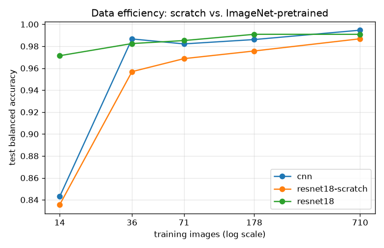
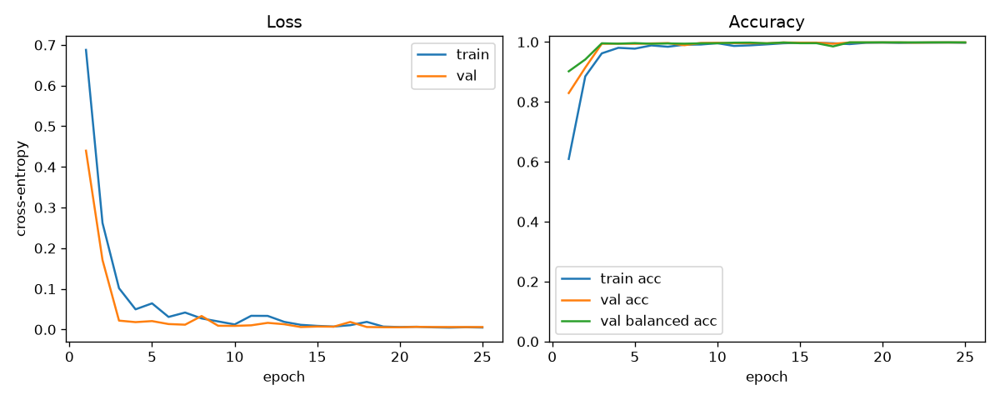
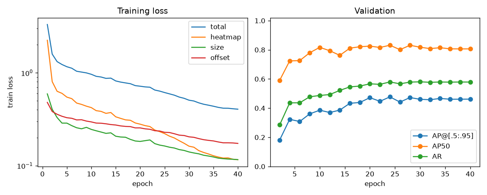
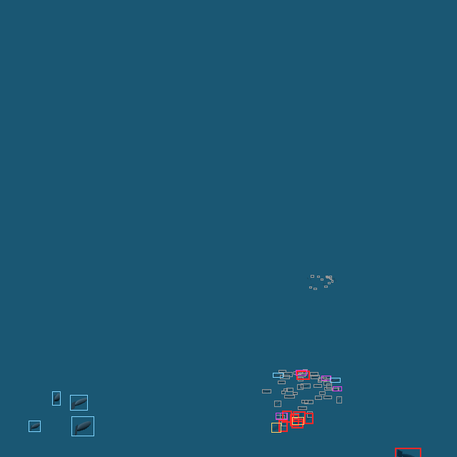

# FishNet

[](https://github.com/husainwafaie/FishNet/actions/workflows/ci.yml)

Synthetic-data fish detection — an end-to-end ML project. A procedural three.js
underwater scene generates unlimited, perfectly labeled training images; a PyTorch
model learns to detect and classify fish species in them; the trained model ships
back into the browser for real-time inference.

The premise: the expensive part of computer vision is labeled data. If you own the
renderer, labels are free — every fish's position, species, and screen-space
bounding box can be computed exactly, for any frame, with zero annotation. This is
the same synthetic-data technique used in robotics and autonomous driving, at
hobby scale.

**Status: Stage 2b baseline detector trained (test AP 0.478, AP50 0.827); error analysis points at occlusion, truncation and the ignore-threshold boundary.**

## Roadmap

| Stage | What | Where |
|---|---|---|
| 1 ✅ | Synthetic scene + automatic pixel-accurate labels | `datagen/` |
| 2a ✅ | Per-instance species classifier; data-efficiency study | `training/` |
| 2b ✅ | CenterNet detector (baseline) + error analysis | `training/` |
| 3 | Evaluation: mAP by depth band and distance, failure analysis | `training/` |
| 4 | ONNX export, quantization, live in-browser inference | `datagen/` |

## Stage 1 — the data generator

```bash
cd datagen
npm install
npm run dev   # http://localhost:5175
```

An interactive underwater scene: three procedural fish species (anchovy, jack,
grouper) scattered in schools through a 90×50×90 water volume, under exponential
fog whose color darkens with depth. **Boxes: on** overlays the computed labels
live — if the boxes hug the fish, the dataset is trustworthy.

**Capture 1 / 100 / 1000** renders randomized 640×640 samples and writes them to
`dataset/images/*.png` + `dataset/labels/*.json` via a dev-server endpoint. Each
sample randomizes:

- the entire fish layout (seeded — the seed is recorded, so any sample can be
  exactly re-rendered)
- camera position, aim, and field of view (aim is biased toward fish so most
  frames have content; empty frames are kept occasionally as natural negatives)
- tail-wag phase

### Label format

```jsonc
{
  "image": "2026-10-29T07-21-28_00001.png",
  "width": 640, "height": 640,
  "seed": 622120360,                  // reproduces layout + camera exactly
  "camera": { "position": [...], "target": [...], "fov": 56.7 },
  "boxes": [
    { "species": "jack", "classId": 1,
      "x": 635, "y": 246, "w": 21, "h": 12,   // pixels, top-left origin
      "distance": 57.96,                       // world units from camera
      "visibility": 0.197 },                   // fog transmittance, 0–1
    { "species": "anchovy", "classId": 0, "ignore": true, ... }
  ]
}
```

### Design decisions that matter for training

- **Visibility is physical, not heuristic.** The labeler computes fog
  transmittance with the exact FogExp2 curve the renderer applies
  (`e^−(density·dist)²`). Fish below 12% transmittance are genuinely invisible in
  the pixels and are not labeled.
- **Ignore regions.** Fish that are visible but tiny (< 80 px²) become
  COCO-style `ignore: true` boxes. Training should mask these regions out of the
  loss — treating specks as background would teach the detector to miss small
  fish, and treating them as positives would add noise.
- **The intended difficulty is depth.** Near the surface the species are easy to
  separate by color. At depth, fog strips color and everything converges to
  murky silhouettes — so the depth/distance fields in every label enable
  evaluation sliced by domain shift (e.g. mAP above vs. below 30 m).
- **Honest caveat:** train and test imagery come from the same renderer, so
  there is no sim-to-real gap to bridge. The studied domain gap here is
  depth/turbidity, and the difficulty can be raised later (more species, tint
  overlap, turbidity randomization).

## Stage 2a — species classifier

```bash
conda env create -f training/environment.yml   # py3.12, torch cu128, editable install
conda activate fishnet
cd training
python -m fishnet.inspect_data                  # split stats, label overlays, crop grids
python -m fishnet.train_classifier --model cnn  # or --model resnet18 [--no-pretrained]
python -m fishnet.sweep_data_efficiency         # learning curves
pytest
```

Non-ignore instances are cropped (square, 25% context pad, shifted inside the
frame) and resized to 64×64. Splits are image-level and assigned by SHA-256 of the
sample key (70/15/15), so crops of one frame never straddle splits and assignments
are stable as the dataset grows.

Dataset: 1,001 frames → 8,876 / 1,859 / 1,694 train/val/test instances; class
imbalance ~10:4:1 (jack:anchovy:grouper), handled with inverse-frequency weighted
cross-entropy and model selection on val balanced accuracy.

**Training:** AdamW, linear warmup + cosine decay, batched on-device augmentation
(hflip, affine RandomResizedCrop, brightness/contrast; no hue/saturation jitter
since colour is a class cue), precise BN before each evaluation, fp32.

### Results (test split)

| Model | Params | Balanced acc | Macro-F1 |
|---|---|---|---|
| SmallCNN (scratch) | 1.17M | 0.995 | 0.995 |
| ResNet-18 (scratch) | 11.2M | 0.987 | 0.988 |
| ResNet-18 (ImageNet init) | 11.2M | 0.991 | 0.992 |

At full data the task saturates: accuracy is flat (≥0.99) across fog visibility
and box-area strata, so the full-data comparison is uninformative. The
data-efficiency sweep (each run ≥1,500 optimizer steps; single seed, so
sub-percent differences are within noise) separates the models:



- ImageNet initialisation dominates in the low-data regime: 0.971 balanced
  accuracy from 14 training frames (159 instances) vs. 0.836–0.843 from scratch.
- Above ~36 frames the scratch SmallCNN matches it; scratch ResNet-18 lags at
  every size, consistent with its 10× parameter count relative to the data.

### Training-stability findings

- **BN running-stat lag.** With EMA BN statistics, eval-mode val accuracy
  oscillated between epochs (e.g. 0.75 / 0.64 balanced) while train accuracy rose
  smoothly. Evaluating the same weights with batch statistics, or with running
  stats re-estimated on the training set, rose monotonically (0.97 → 0.99),
  isolating the cause to running-stat lag rather than augmentation shift.
  Precise BN (`swa_utils.update_bn`) before each eval removes the oscillation and
  brings val ≥ 0.99 forward from epoch 14 to epoch 3.
  
- **fp16 on GTX 16-series.** Under fp16 autocast, cuDNN conv kernels produced NaN
  logits for some batch shapes (ResNet-18, n=31); GradScaler silently skipped
  those steps. BN statistic accumulation under autocast also overflowed. AMP is
  therefore opt-in (`--amp`).

## Stage 2b — detector

```bash
python -m fishnet.train_detector --overfit 8 --epochs 150 --eval-every 25   # pipeline sanity check
python -m fishnet.train_detector --run-name centernet-r18-baseline
python -m fishnet.inspect_detector centernet-r18-baseline                   # error analysis
```

**Model.** CenterNet-style, NMS-free: ImageNet ResNet-18 backbone with frozen BN
(FrozenBatchNorm2d), a top-down GroupNorm neck (1×1 laterals + nearest upsample,
C5 → stride 4, 128 ch) and three heads (per-class centre heatmap, log-size, sub-cell
offset). 11.96M parameters. Decoding is 3×3 max-pool peak extraction + top-300.

**Targets.** TTFNet-style elliptical Gaussians (σ = 0.54·size/6) on a stride-4 grid;
L1 on log(w), log(h) and offsets at centre cells; on centre-cell collisions the
smaller instance owns the regression targets. Ignore boxes zero the *negative*
focal-loss term for all classes (positives inside them are still supervised).

**Loss / optimisation.** Penalty-reduced focal loss (α=2, β=4) + L1 terms (weights
1/1/1); AdamW (lr 3e-4, wd 1e-4), 1-epoch warmup + cosine, grad-norm clip 35,
batch 8, 40 epochs, fp32, hflip + brightness/contrast jitter. Model selection on val
AP@[.5:.95] every 2 epochs.

**Evaluation.** pycocotools COCOeval with maxDets=300 and ignore boxes registered as
`iscrowd=1` under every category, so detections on ignore regions are neither TP
nor FP regardless of class. Area ranges match the classifier strata
(<150, 150–400, 400–1500, >1500 px²). An `--overfit 8` run (150 steps) reaches AP
0.944 on its own training frames, validating targets → loss → decode → eval.

### Results (test, 140 frames, 1,694 instances)

| AP@[.5:.95] | AP50 | AP75 | AR@300 |
|---|---|---|---|
| 0.478 | 0.827 | 0.503 | 0.567 |

| | anchovy | jack | grouper | | <150 px² | 150–400 | 400–1500 | >1500 |
|---|---|---|---|---|---|---|---|---|
| AP | 0.325 | 0.468 | 0.642 | | 0.349 | 0.473 | 0.586 | 0.576 |



Val AP plateaus from ~epoch 20 (best: epoch 24) while training loss keeps falling;
the AP50–AP gap reflects localisation precision on small boxes, where a 1–2 px
error fails the stricter IoU thresholds.

### Error analysis

Operating point chosen on val (max F1@IoU0.5 → score 0.40): test precision 0.871,
recall 0.771, F1 0.818. Recall stratified on test:

| Factor | Strata → recall |
|---|---|
| Nearer-instance box coverage | <25%: 0.842 · 25–50%: 0.744 · 50–75%: 0.540 · ≥75%: 0.288 |
| Frame-edge truncation | interior: 0.784 · edge: 0.589 |
| Box area (px²) | <150: 0.693 · 150–400: 0.762 · 400–1500: 0.876 · >1500: 0.800 |
| Fog visibility | <0.3: 0.725 · 0.3–0.5: 0.783 · 0.5–0.7: 0.839 · ≥0.7: 0.756 |

False positives at the operating point: 128 background, 57 mislocalised
(including duplicates), 9 wrong-class. Findings:

- **Occlusion dominates.** The labeler emits every in-frustum instance regardless of
  occlusion; ~6% of positives are ≥75% box-covered by nearer fish (~2% ≥95%), and
  recall on them is 0.29. Part of this is label noise rather than model error;
  per-instance visible-pixel fractions from an ID-buffer render would fix it at the
  source.
- **Truncation** at the frame edge costs ~20 points of recall.
- **Fog/depth is a weak factor** at this difficulty; the non-monotonic visibility
  curve is likely confounded with proximity (near instances are larger, more often
  truncated, and inside dense close-range schools).
- **Classification is solved** (9 wrong-class FPs), consistent with Stage 2a.
- Errors concentrate in distant schools where ignore specks (<80 px²) neighbour
  barely-positive instances: the hard area threshold makes near-identical objects
  alternately ignored and supervised.



## Architecture

```
datagen/
├── vite.config.ts        Dev server + /api/save endpoint (writes dataset/)
└── src/
    ├── lib/prng.ts       Seeded PRNG — every layout is a pure function of seed
    ├── scene/
    │   ├── environment.ts  Depth-graded fog/lighting, dune seafloor
    │   ├── species.ts      The class list: sizes, colors, depth bands
    │   ├── fishGeometry.ts Procedural fish (head at +Z — labeler relies on it)
    │   └── FishField.ts    InstancedMesh per species; CPU-side transforms
    └── capture/
        ├── labeler.ts      Projects instance bboxes → pixel-space labels
        ├── overlay.ts      Live label visualization (the proof of correctness)
        └── recorder.ts     Randomized batch capture → POST /api/save

training/
├── environment.yml       conda env (py3.12, torch cu128)
├── fishnet/
│   ├── labels.py         Label JSON → typed Sample/Box; class list
│   ├── splits.py         Hash-based image-level train/val/test
│   ├── crops.py          Instance crops, cached uint8 NCHW, on-device batching
│   ├── augment.py        Batched on-device augmentation + normalisation
│   ├── models.py         SmallCNN, ResNet-18
│   ├── metrics.py        Confusion, per-class P/R/F1, stratified accuracy
│   ├── train_classifier.py
│   ├── sweep_data_efficiency.py
│   ├── inspect_data.py
│   ├── train_detector.py
│   ├── inspect_detector.py   Threshold selection, stratified recall, FP taxonomy
│   └── detection/
│       ├── targets.py        Box → heatmap/size/offset/ignore encoding
│       ├── decode.py         NMS-free peak decoding
│       ├── model.py          CenterNet (ResNet-18, frozen BN, GN neck)
│       ├── loss.py           Focal heatmap loss with ignore mask, masked L1
│       ├── data.py           Full-frame dataset, box-consistent hflip
│       ├── evaluate.py       COCO AP/AR with class-agnostic ignore regions
│       └── analysis.py       IoU, greedy matching, occlusion proxy
└── tests/
```
